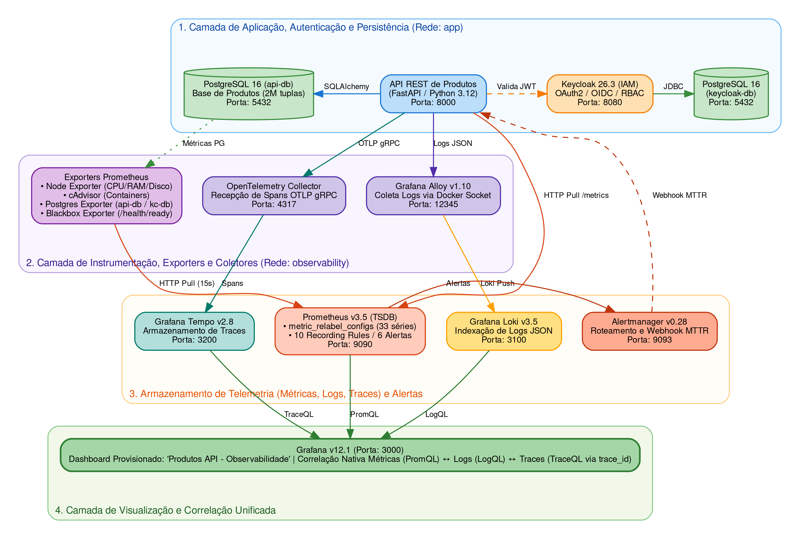
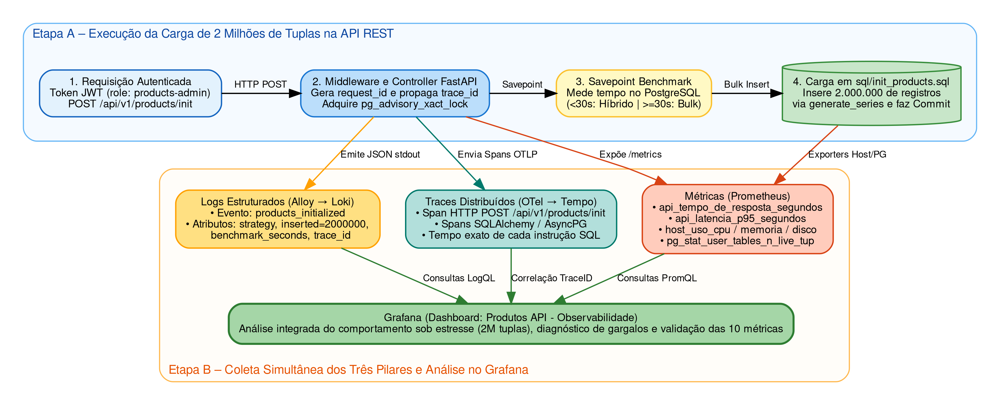

# Atividade final: API de produtos e observabilidade

Projeto independente com foco em estudo sobre a observabilidade. A aplicação usa FastAPI, Pydantic, SQLAlchemy assíncrono e PostgreSQL. O Keycloak autentica as rotas de produtos; Prometheus, Grafana, Loki, Tempo e OpenTelemetry compõem o laboratório de observabilidade.

## Requisitos e inicialização

- Docker Engine com Docker Compose v2.
- Python 3.12 e `uv` para executar testes e ferramentas localmente.

```sh
cp .env.example .env
# Edite as senhas de desenvolvimento em .env.
docker compose up --build -d
docker compose ps
./scripts/smoke.sh
```

A API cria as tabelas ao iniciar. O Compose mantém volumes separados para o banco de produtos, o banco do Keycloak e os dados de Prometheus, Grafana, Loki, Tempo e Alertmanager. A stack foi preparada para uso local: as portas publicadas ficam vinculadas a `127.0.0.1`; não use as credenciais de exemplo em ambientes compartilhados.

## Endereços locais

| Serviço | Endereço |
| --- | --- |
| API e OpenAPI | http://localhost:8000/docs |
| Keycloak | http://localhost:8081 |
| Grafana | http://localhost:3000 |
| Prometheus | http://localhost:9090 |
| Alertmanager | http://localhost:9093 |
| Loki API | http://localhost:3100 |
| Tempo API | http://localhost:3200 |

O login administrativo do Keycloak e do Grafana usa os valores definidos em `.env`. Para testar a API, crie no realm `observabilidade` um usuário local, defina senha e atribua a role `products-user` ou `products-admin`. `products-admin` também dá acesso ao CRUD. O Swagger está configurado com o fluxo de senha OAuth2 do cliente público `products-api`: abra `/docs`, clique em **Authorize**, informe usuário e senha do Keycloak e confirme. O Swagger solicita o token diretamente ao Keycloak e o aplica automaticamente às operações protegidas. O realm de demonstração habilita o fluxo direto e permite a origem `http://localhost:8000`.

Para iniciar a carga de demonstração, autentique no Swagger com um usuário que tenha a role `products-admin` e execute a operação `POST /api/v1/products/init` diretamente pela interface.

`/init` completa a tabela até 2.000.000 de registros e não duplica a carga em chamadas subsequentes. O primeiro ensaio executa o bulk insert em uma transação descartável e mede o tempo. Se durar menos de 30 segundos, a inserção efetiva combina 100 registros individuais com o bulk dos demais; caso contrário, usa bulk. Assim, o benchmark não altera dados antes de escolher a estratégia.

## API

| Método e rota | Ação |
| --- | --- |
| `GET /api/v1/products?limit=50&offset=0` | Listar produtos paginados |
| `POST /api/v1/products` | Criar produto |
| `GET /api/v1/products/{id}` | Consultar produto |
| `PUT /api/v1/products/{id}` | Substituir os campos do produto |
| `DELETE /api/v1/products/{id}` | Remover produto |
| `POST /api/v1/products/init` | Criar a carga de demonstração (admin) |
| `GET /health/live` | Verificar processo da API |
| `GET /health/ready` | Verificar API e banco de produtos |
| `GET /metrics` | Métricas Prometheus (rede local do Compose) |

`name` e `link` aceitam até 256 caracteres; `description`, até 1.000. A API responde 422 para dados inválidos, 401 para token ausente/inválido, 403 para role insuficiente e 404 para produto inexistente. As exceções inesperadas são registradas e retornam uma mensagem genérica.

## Arquitetura da Solução e do Experimento

### Arquitetura Geral dos Serviços e Observabilidade



### Fluxo do Experimento de Carga (2 Milhões de Tuplas)



## Observabilidade

Prometheus coleta `/metrics` da API, Keycloak, Alertmanager, Loki, Tempo, Alloy, Collector, cAdvisor, Node Exporter, Blackbox Exporter e um exporter para cada Postgres. Os jobs têm `metric_relabel_configs` com uma allowlist estrita das métricas usadas nos painéis e alertas (reduzindo o catálogo do Grafana de 1.769 para 34 séries) e `recording_rules.yml` consolida os 10 indicadores principais em português (`api_tempo_de_resposta_segundos`, `api_latencia_p95_segundos`, `api_throughput_requisicoes_por_segundo`, `host_uso_cpu_percentual`, `host_uso_memoria_percentual`, `host_espaco_disco_percentual`, `api_numero_de_requisicoes_total`, `api_taxa_de_erros_por_minuto`, `api_disponibilidade_ratio` e `sistema_tempo_medio_recuperacao_mttr_segundos`). As métricas brutas da aplicação são `products_http_requests_total`, `products_http_request_duration_seconds_*` e `products_incident_recovery_duration_seconds_*`; exporters fornecem disponibilidade (`up`, `probe_success`), CPU, memória, disco e estatísticas de tuplas do banco (`pg_stat_user_tables_n_live_tup` e `pg_stat_database_tup_inserted`). Alloy descobre containers Docker e encaminha seus logs para Loki. A instrumentação OpenTelemetry da API cria spans HTTP, SQLAlchemy e chamadas HTTPX de validação JWKS; o Collector agrega e encaminha traces para Tempo. O desenho usa os princípios de [instrumentação Prometheus](https://prometheus.io/docs/practices/instrumentation/), [métricas internas do Collector](https://opentelemetry.io/docs/collector/internal-telemetry/), [coleta de traces com OpenTelemetry](https://opentelemetry.io/docs/collector/deployment/gateway/) e [coleta de logs Docker com Alloy](https://grafana.com/docs/alloy/latest/monitor/monitor-docker-containers/).

O dashboard provisionado **Produtos API - Observabilidade** apresenta disponibilidade, CPU, memória, disco, latência p95, erros por minuto, requisições por segundo, duração média, rotas mais lentas, tuplas ativas e taxa de inserções/s no PostgreSQL e MTTR. As séries de aplicação usam rota normalizada e classe de status, sem IDs de usuário como labels.

Alertas provisionados: CPU acima de 80%, memória acima de 90%, latência p95 acima de 500 ms, indisponibilidade de API/Keycloak/Postgres e disco acima de 90%. Há também alerta para taxa de erro HTTP acima de 5%. Alertmanager envia eventos de disparo e resolução ao endpoint da API, acessível somente pela rede Compose; o endpoint não tem porta própria publicada. A API persiste as ocorrências e observa a duração como `products_incident_recovery_duration_seconds`, usada no cálculo de MTTR.

### Logs, rastros e causa raiz

- **Login:** eventos de autenticação e eventos administrativos do Keycloak são enviados ao log do container e coletados pelo Alloy.
- **API:** logs JSON incluem método, rota, status, duração, request ID e trace ID. Criação, alteração, exclusão, carga de dados, exceções e resolução de alertas geram eventos de auditoria/diagnóstico. Tokens, senhas e corpos de requisição não são registrados.
- **Traces:** cada requisição tem spans HTTP; consultas SQL e chamadas de validação de chave pública do Keycloak recebem spans filhos. O trace ID aparece nos logs da API e permite navegar de uma ocorrência no Loki para o trace correspondente no Tempo, inspecionando os tempos por etapa e erros para localizar a causa raiz.

Tempo está configurado em modo monolítico para este Compose de nó único, com ring do ingester e do `metrics_generator` (`local-blocks`) em `inmemory` e fator de replicação 1, habilitando consultas TraceQL de agregação na aba Breakdown/Drilldown do Grafana. Se o Grafana reportar `empty ring` após uma alteração de configuração, recrie `tempo` e `otel-collector`; para aplicar a allowlist de métricas, recrie também Prometheus. Aguarde os serviços iniciarem e gere uma nova requisição na API para criar spans recentes:

```sh
docker compose up -d --force-recreate tempo otel-collector prometheus
docker compose logs --tail=100 tempo otel-collector prometheus
```

O endpoint `http://localhost:3200/ingester/ring` permite verificar se o ingester foi registrado como `ACTIVE`. A mudança de ring não exige apagar o volume de traces.

As métricas contemplam contagem e taxa de requisições, throughput, duração média e p95, taxa 4xx/5xx, disponibilidade sintética, CPU, memória, disco, disponibilidade e tuplas inseridas/ativas no PostgreSQL, além do MTTR.

## Testes e qualidade

```sh
uv sync --group dev
uv run pytest
uv run ruff check app tests
uv run mypy app
uv run bandit -r app
uv run pip-audit
```

Os testes unitários cobrem autenticação, serviços, repositórios, seed e funções auxiliares. Os testes de integração usam SQLite temporário para exercitar as rotas de CRUD, validações, permissões, webhook de alertas e métricas; o smoke test em Docker verifica a integração real com Postgres e os coletores.

```sh
docker compose logs -f api keycloak api-db
docker compose down                 # preserva volumes
docker compose down -v              # apaga os dados locais
```

## Configuração

As variáveis são documentadas em `.env.example`. Há senhas administrativas separadas para os dois Postgres; a API e o Keycloak conectam com usuários de aplicação não superusuários, e o PostgreSQL Exporter usa um usuário com `pg_monitor`. A API usa `DATABASE_URL`, `KEYCLOAK_ISSUER`, `KEYCLOAK_JWKS_URL`, `KEYCLOAK_CLIENT_ID`, `OTEL_EXPORTER_OTLP_ENDPOINT` e `SEED_TARGET_COUNT`. O Compose define as URLs internas; o issuer permanece no endereço publicado do Keycloak para corresponder ao claim `iss` dos tokens.

